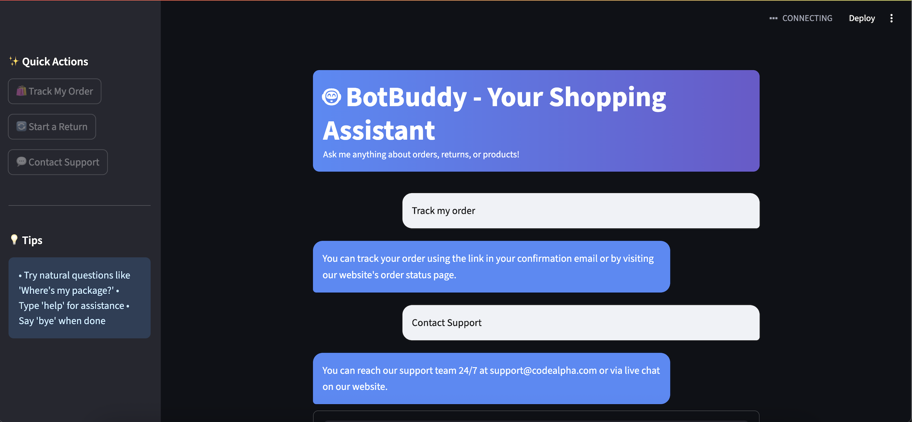
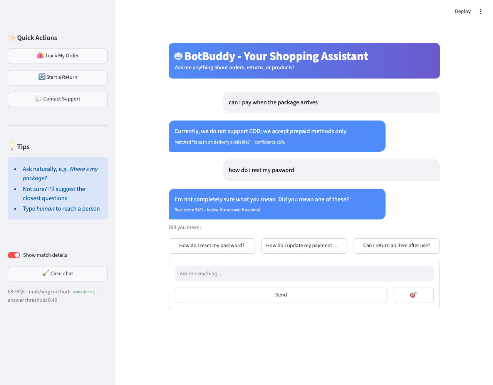

# 🤖 BotBuddy – FAQ Chatbot

[](https://github.com/Shivani-Radhakrishnan/CodeAlpha_FAQChatbot/actions/workflows/tests.yml)

BotBuddy is a customer-support FAQ chatbot built with **Python**, **Streamlit**, **scikit-learn** and **sentence embeddings**. It matches a user's question to the closest entry in a 68-question knowledge base, shows how confident it is, and when it isn't sure it asks *"Did you mean…?"* instead of guessing. Built for the CodeAlpha internship.

The matching logic is a small, typed, tested Python package, and it is measured on a held-out set of paraphrased questions so that changes to it can be compared with numbers.



| Confident answer vs. "Did you mean…?" |
|---|
|  |

---

## Features

- **Semantic matching.** Sentence embeddings (`all-MiniLM-L6-v2`, runs on CPU) match questions worded differently from the FAQ, e.g. *"can I pay when the package arrives"* → *Is cash on delivery available?*
- **Lightweight fallback.** If `sentence-transformers` isn't installed, the app uses a TF-IDF method built on character n-grams, which copes with typos.
- **Confidence display.** Each answer shows the FAQ it matched and the match score (can be turned off in the sidebar).
- **"Did you mean…?"** When the score is just under the answer threshold, the bot offers up to three distinct FAQs as one-click buttons.
- **Out-of-scope fallback.** Off-topic questions (*"who won the world cup"*) get a polite fallback, not a random FAQ.
- **Streamlit UI.** Quick-action buttons, a random example question, a clear-chat button, and confetti when you say thanks. User text is HTML-escaped before display.

## Results

Measured on `data/eval_questions.csv`: 196 hand-written questions that are **not** in the FAQ file. There are 2–3 paraphrases for each FAQ (different wording, some with typos) plus 30 out-of-scope questions. Each method's answer threshold is tuned on the **dev** split (78 questions), and the scores below are on the **test** split (98 in-scope + 20 out-of-scope), which is never used for tuning.

| Method | Top-1 | Top-3 | End-to-end | Fallback precision | Fallback recall | Answer or suggestion | Threshold (dev-tuned) |
|---|---|---|---|---|---|---|---|
| `keyword` (baseline: word overlap) | 34.7% | 48.0% | 40.7% | 30.6% | 75.0% | 33.7% | 0.08 |
| `tfidf` (word TF-IDF + token similarity) | 29.6% | 46.9% | 25.4% | 11.6% | 25.0% | 36.7% | 0.37 |
| `hybrid` (char n-gram + Q&A TF-IDF) | 53.1% | 69.4% | 49.2% | 56.2% | 45.0% | 52.0% | 0.18 |
| **`embedding`** (default) | **85.7%** | **93.9%** | **83.9%** | **65.5%** | **95.0%** | **87.8%** | 0.40 |

- **Top-1 / Top-3**: share of in-scope questions where a correct FAQ is ranked first, or in the first three.
- **End-to-end**: share of *all* test questions handled correctly. In-scope questions must be answered with a correct FAQ; out-of-scope questions must not be answered.
- **Fallback precision / recall**: how well "not answering" picks out the out-of-scope questions.
- **Answer or suggestion**: share of in-scope questions that get a correct answer, or a correct FAQ among the *Did you mean* buttons.
- Some FAQs are near-duplicates (*Hi* / *Hello*, *Where's my order?* / *Can I track my order?*), so the eval file lists every FAQ that counts as a correct answer.

Reproduce:

```bash
python -m botbuddy.evaluate                                    # keyword, tfidf, hybrid
python -m botbuddy.evaluate --methods keyword tfidf hybrid embedding   # needs requirements-embedding.txt
```

CI runs the first command on every push. The tuned thresholds are stored in `botbuddy/config.py`, and a test checks that they match what the script tunes.

**What the numbers say:** most test paraphrases share few words with their FAQ, so methods based only on shared words do poorly. Adding character n-grams and the answer text (`hybrid`) improves top-1 from 35% to 53%. Sentence embeddings reach 86% top-1 and turn away 19 of the 20 off-topic questions. Two things were tried and rejected because they did not improve the dev split: a TF-IDF + embedding ensemble, and spelling correction against the FAQ vocabulary before embedding.

## How it works

```
user question
   │  normalise: lower-case, fold quotes/accents, expand contractions ("where's" → "where is")
   ▼
scorer (one of: keyword · tfidf · hybrid · embedding) ──► score in [0, 1] for every FAQ
   ▼
best score ≥ threshold            → answer + confidence
threshold × 0.6 ≤ best < threshold → "Did you mean…?" with up to 3 distinct FAQs
otherwise                         → fallback message
```

- `hybrid`: 50% character 2–4-gram TF-IDF over the question (handles *"trak my ordr"*) and 50% stemmed word TF-IDF over the question **and its answer**, so *"paypal"* finds *What payment methods are accepted?* through the answer text.
- `embedding`: `max(cos(q, question), 0.8 · cos(q, answer))` with normalised MiniLM embeddings.
- `auto` (the app default) uses `embedding` if it loads and otherwise falls back to `hybrid`, logging a warning.

## Quick start

```bash
git clone https://github.com/Shivani-Radhakrishnan/CodeAlpha_FAQChatbot.git
cd CodeAlpha_FAQChatbot
python -m venv .venv && source .venv/bin/activate

pip install -r requirements.txt              # lightweight (hybrid matcher)
pip install -r requirements-embedding.txt    # optional: best accuracy (downloads PyTorch + a 90 MB model)

streamlit run chatbot.py
```

Use the matcher from Python:

```python
from botbuddy.matcher import FAQMatcher

bot = FAQMatcher.from_csv()          # method="auto": embedding if installed, else hybrid
result = bot.respond("how long until I get my money back")
print(result.status, result.answer, f"{result.score:.2f}")
# embedding: answer Refunds are processed within 5-7 business days after we receive your return. 0.67
# (the lightweight hybrid method gets this paraphrase wrong; see Results)
```

To add an FAQ, append a row to `faq_data.csv` (`Question,Answer`). Duplicate and blank rows are skipped with a warning.

## Tests

```bash
pip install -r requirements-dev.txt
pytest
```

The tests cover:

- text normalisation
- CSV loading and its error cases
- every FAQ mapping to its own answer
- typo tolerance
- out-of-scope questions falling back
- "Did you mean" de-duplication
- `auto` falling back when embeddings aren't available
- the evaluation metrics and the eval set's hold-out guarantees
- Streamlit UI smoke tests (`streamlit.testing`)

The embedding tests are skipped when `sentence-transformers` isn't installed, as in CI. No NLTK data downloads are needed, because only the Porter stemmer is used.

## Project structure

```
botbuddy/
  config.py     paths, default method, tuned thresholds, messages
  text.py       normalisation, tokenisation, stemming
  matcher.py    FAQ loading, scorers, FAQMatcher (answer / suggest / fallback)
  evaluate.py   held-out evaluation (python -m botbuddy.evaluate)
chatbot.py      Streamlit UI
faq_data.csv    knowledge base (68 Q&A pairs)
data/eval_questions.csv   held-out paraphrases + out-of-scope questions (dev/test split)
tests/          pytest suite
```

## Limitations

- The eval set is small (98 in-scope test questions) and was written by the project author, so differences of a few points are within noise.
- Embeddings handle typos less well than the character n-gram method. Heavily misspelled questions often get a *Did you mean* prompt instead of a direct answer.
- The knowledge base is a fictional store; answers are placeholders.

## License

[MIT](LICENSE)
