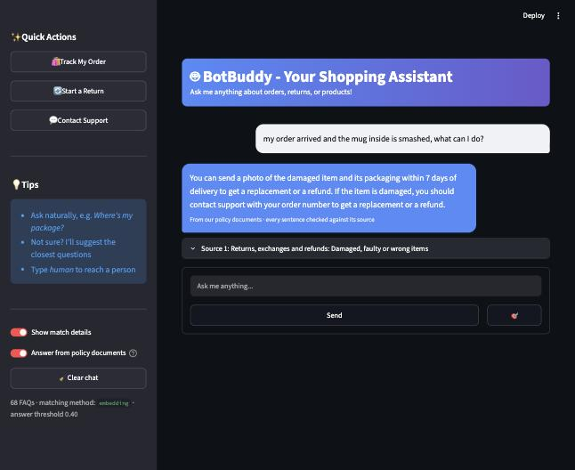

# BotBuddy: FAQ Chatbot with Grounded, Cited Answers

[](https://github.com/Shivani-Radhakrishnan/botbuddy-rag-faq/actions/workflows/tests.yml)

BotBuddy is a customer-support chatbot that **answers from a store's policy documents with citations**, using a local language model (Qwen2.5-1.5B through llama.cpp). It retrieves the relevant sections, writes a short answer, checks every sentence against the section it comes from, cites that section, and declines when the documents don't cover the question. On 98 held-out questions it handles **82.7%** correctly, against 44.9% for a plain FAQ matcher and 14.3% for the same model without the documents.

Underneath is a fast FAQ matcher built with **Python**, **Streamlit**, **scikit-learn** and **sentence embeddings**. It matches a question to the closest entry in a 68-question knowledge base, shows how confident it is, and when it isn't sure it asks *"Did you mean…?"* instead of guessing.

The matching and answering logic is a small, typed, tested Python package, measured on held-out questions so that changes can be compared with numbers.

*Background: started as a project for the CodeAlpha internship and extended since.*


| Confident answer vs. "Did you mean…?" | Answer from the policy documents, with its source |
|---|---|
|  |  |

---

## Features

- **Semantic matching.** Sentence embeddings (`all-MiniLM-L6-v2`, runs on CPU) match questions worded differently from the FAQ, e.g. *"can I pay when the package arrives"* → *Is cash on delivery available?*
- **Answers from policy documents (optional).** Seven policy pages (returns, shipping, payments, warranty, account, rewards, support) are split into 39 sections. A question is matched to sections by embeddings plus BM25; a local LLM answers from the top three; each sentence is kept only if a retrieved section supports it, and that section is shown as the source. Nothing relevant retrieved, or nothing supported, means the bot declines instead of guessing.
- **No PyTorch needed.** The embedding model runs through ONNX Runtime, with the same scores as `sentence-transformers` (the results below reproduce exactly).
- **Lightweight fallback.** Without the embedding dependencies, the app uses a TF-IDF method built on character n-grams, which copes with typos.
- **Confidence display.** Each answer shows the FAQ it matched and the match score (can be turned off in the sidebar).
- **"Did you mean…?"** When the score is just under the answer threshold, the bot offers up to three distinct FAQs as one-click buttons.
- **Out-of-scope fallback.** Off-topic questions (*"who won the world cup"*) get a polite fallback, not a random FAQ.
- **Streamlit UI.** Quick-action buttons, a random example question, a clear-chat button, and confetti when you say thanks. User text is HTML-escaped before display.

## Results

Measured on `data/eval_questions.csv`: 196 hand-written questions that are **not** in the FAQ file. There are 2–3 paraphrases for each FAQ (different wording, some with typos) plus 30 out-of-scope questions. Each method's answer threshold is tuned on the **dev** split (78 questions), and the scores below are on the **test** split (98 in-scope + 20 out-of-scope), which is never used for tuning.

| Method | Top-1 | Top-3 | End-to-end | Fallback precision | Fallback recall | Answer or suggestion | Threshold (dev-tuned) |
|---|---|---|---|---|---|---|---|
| `keyword` (baseline: word overlap) | 34.7% | 48.0% | 40.7% | 30.6% | 75.0% | 33.7% | 0.08 |
| `tfidf` (word TF-IDF + token similarity) | 29.6% | 46.9% | 25.4% | 11.6% | 25.0% | 36.7% | 0.37 |
| `hybrid` (char n-gram + Q&A TF-IDF) | 53.1% | 69.4% | 49.2% | 56.2% | 45.0% | 52.0% | 0.18 |
| **`embedding`** (default) | **85.7%** | **93.9%** | **83.9%** | **65.5%** | **95.0%** | **87.8%** | 0.40 |

- **Top-1 / Top-3**: share of in-scope questions where a correct FAQ is ranked first, or in the first three.
- **End-to-end**: share of *all* test questions handled correctly. In-scope questions must be answered with a correct FAQ; out-of-scope questions must not be answered.
- **Fallback precision / recall**: how well "not answering" picks out the out-of-scope questions.
- **Answer or suggestion**: share of in-scope questions that get a correct answer, or a correct FAQ among the *Did you mean* buttons.
- Some FAQs are near-duplicates (*Hi* / *Hello*, *Where's my order?* / *Can I track my order?*), so the eval file lists every FAQ that counts as a correct answer.

Reproduce:

```bash
python -m botbuddy.evaluate                                    # keyword, tfidf, hybrid
python -m botbuddy.evaluate --methods keyword tfidf hybrid embedding   # needs requirements-embedding.txt
```

CI runs the first command on every push. The tuned thresholds are stored in `botbuddy/config.py`, and a test checks that they match what the script tunes.

**What the numbers say:** most test paraphrases share few words with their FAQ, so methods based only on shared words do poorly. Adding character n-grams and the answer text (`hybrid`) improves top-1 from 35% to 53%. Sentence embeddings reach 86% top-1 and turn away 19 of the 20 off-topic questions. Two things were tried and rejected because they did not improve the dev split: a TF-IDF + embedding ensemble, and spelling correction against the FAQ vocabulary before embedding.

### Answers from the policy documents

`data/rag_questions.csv` holds 143 hand-written questions, written before the system was
built: answerable ones list the section(s) with the answer and the facts a correct reply
must contain (*"30 days"*, *"5.95"*); *not covered* ones are about the store but not in
the documents (*"do you sell furniture"*), and *off-topic* ones aren't about the store.
Thresholds were tuned on the 45 dev questions; the 98 test questions were scored once.

| System | Overall | Answerable: correct | Answerable: wrongly declined | Not covered: declined | Off-topic: declined | Citation correct |
|---|---|---|---|---|---|---|
| FAQ matcher (above) | 44.9% | 47.1% | 13.2% | 15.0% | 90.0% | – |
| Same LLM, no documents | 14.3% | 16.2% | 23.5% | 15.0% | 0.0% | – |
| RAG, no grounding check | 83.7% | 88.2% | 1.5% | 60.0% | 100.0% | 86.6% |
| **RAG with grounding check** | **82.7%** | **85.3%** | **2.9%** | **65.0%** | **100.0%** | **93.9%** |

- **Without documents the model makes policies up**: it answers 85% of the not-covered
  questions and gets 16% of the real ones right. Retrieval is what makes it useful; the
  right section is in the top three for 98.5% of answerable questions.
- **The grounding check trades a little accuracy for trust**: citations become correct far
  more often (93.9% vs 86.6%) and more not-covered questions are declined (65% vs 60%), at
  the cost of two answerable questions; overall it is one question lower.
- **What still goes wrong** (every error is listed in [`data/rag_results.md`](data/rag_results.md)):
  the check measures similarity, so it cannot see a flipped *yes/no* ("final-sale items are
  returnable" against a source saying they aren't) or a wrong number taken from a nearby
  section ("the warranty is 3 years"); and a third of not-covered questions still get an
  answer stitched from a related section. An entailment model in the check is the next step.
- While tuning on dev, citations are attributed after generation (each sentence to the
  section that supports it best), because the 1.5B model's own `[n]` markers are often
  missing or wrong.

The evaluation replays the model's recorded outputs (`data/rag_llm_cache.json`), so
`python -m botbuddy.rag_eval` reproduces the table in seconds without the model; the tests
check this.

## How it works

```
user question
   │  normalise: lower-case, fold quotes/accents, expand contractions ("where's" → "where is")
   ▼
scorer (one of: keyword · tfidf · hybrid · embedding) ──► score in [0, 1] for every FAQ
   ▼
best score ≥ threshold            → answer + confidence
threshold × 0.6 ≤ best < threshold → "Did you mean…?" with up to 3 distinct FAQs
otherwise                         → fallback message
```

- `hybrid`: 50% character 2–4-gram TF-IDF over the question (handles *"trak my ordr"*) and 50% stemmed word TF-IDF over the question **and its answer**, so *"paypal"* finds *What payment methods are accepted?* through the answer text.
- `embedding`: `max(cos(q, question), 0.8 · cos(q, answer))` with normalised MiniLM embeddings.
- `auto` (the app default) uses `embedding` if it loads and otherwise falls back to `hybrid`, logging a warning.

Document answers (sidebar switch *Answer from policy documents*):

```
question ──► retrieve 3 sections (MiniLM cosine, best of section or sentence, + BM25)
   │           best similarity < 0.25 ───────────────────────────► decline (no LLM call)
   ▼
Qwen2.5-1.5B (llama.cpp, temperature 0): answer from the numbered sources,
   │           or NOT_IN_SOURCES ─────────────────────────────────► decline
   ▼
grounding check: keep each sentence whose best match in a retrieved section is ≥ 0.5,
   │           cite that section;  nothing kept ─────────────────► decline
   ▼
answer + sources (shown under the reply)
```

Small talk (*"hi"*, *"human"*) isn't in the policies, so it still goes to the FAQ matcher.

## Quick start

```bash
git clone https://github.com/Shivani-Radhakrishnan/botbuddy-rag-faq.git
cd botbuddy-rag-faq
python -m venv .venv && source .venv/bin/activate

pip install -r requirements.txt              # lightweight (hybrid matcher)
pip install -r requirements-embedding.txt    # optional: best accuracy (ONNX Runtime + a 90 MB model)
pip install -r requirements-rag.txt          # optional: answers from the policy documents (llama.cpp + a 1.1 GB model)

streamlit run chatbot.py
```

Use the matcher from Python:

```python
from botbuddy.matcher import FAQMatcher

bot = FAQMatcher.from_csv()          # method="auto": embedding if installed, else hybrid
result = bot.respond("how long until I get my money back")
print(result.status, result.answer, f"{result.score:.2f}")
# embedding: answer Refunds are processed within 5-7 business days after we receive your return. 0.67
# (the lightweight hybrid method gets this paraphrase wrong; see Results)
```

To add an FAQ, append a row to `faq_data.csv` (`Question,Answer`). Duplicate and blank rows are skipped with a warning.

## Tests

```bash
pip install -r requirements-dev.txt
pytest
```

The tests cover:

- text normalisation
- CSV loading and its error cases
- every FAQ mapping to its own answer
- typo tolerance
- out-of-scope questions falling back
- "Did you mean" de-duplication
- `auto` falling back when embeddings aren't available
- the evaluation metrics and the eval set's hold-out guarantees
- Streamlit UI smoke tests (`streamlit.testing`), including a document answer with its source
- document answers: section chunking, citation-aware sentence splitting, retrieval, declining,
  the grounding check (with a fake model), the replay cache, and that the published RAG
  results reproduce from the recorded outputs

Embedding and RAG tests need the ONNX dependencies (`requirements-embedding.txt`), which CI
installs; llama.cpp is never needed for the tests. No NLTK data downloads are needed,
because only the Porter stemmer is used.

## Project structure

```
botbuddy/
  config.py     paths, default method, tuned thresholds, messages
  text.py       normalisation, tokenisation, stemming
  matcher.py    FAQ loading, scorers, FAQMatcher (answer / suggest / fallback)
  evaluate.py   held-out evaluation (python -m botbuddy.evaluate)
  encoder.py    all-MiniLM-L6-v2 through ONNX Runtime
  rag.py        policy sections, retrieval, grounded answers with citations
  llm.py        Qwen2.5-1.5B through llama.cpp, and the record/replay cache
  rag_eval.py   document-answer evaluation (python -m botbuddy.rag_eval)
chatbot.py      Streamlit UI
faq_data.csv    knowledge base (68 Q&A pairs)
data/eval_questions.csv   held-out paraphrases + out-of-scope questions (dev/test split)
data/policies/            the store's policy pages (Markdown)
data/rag_questions.csv    document-answer questions with gold sections and required facts
data/rag_llm_cache.json   recorded model outputs, so the evaluation replays without the model
tests/          pytest suite
```

## Limitations

- The eval set is small (98 in-scope test questions) and was written by the project author, so differences of a few points are within noise.
- Embeddings handle typos less well than the character n-gram method. Heavily misspelled questions often get a *Did you mean* prompt instead of a direct answer.
- The knowledge base and policies are for a fictional store, written for this project.
- Document answers come from a 1.5B model on a laptop: it misreads negations and sometimes
  copies the wrong number from a neighbouring section, which the similarity-based check can't
  catch (see Results). The question set has 98 test questions, so one question is about 1 point.

## License

[MIT](LICENSE)
